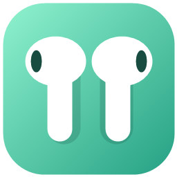
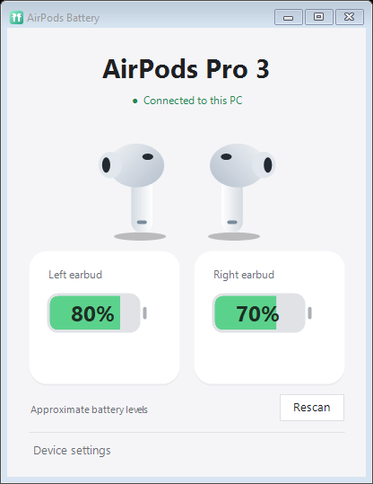

<p align="center"></p>

# AirPods Battery for Windows

**See your AirPods battery level on Windows 11, right from the system tray.** A small, free, open-source desktop app showing left and right earbud percentages, charging state, and disconnect notifications.

Built for everyday listening on a Windows PC. **Tested with AirPods Pro 3; other recognized AirPods earbuds are enabled experimentally.** Community compatibility reports are welcome.



*Illustrative app render with synthetic readings, not a claim of precise battery measurement.*

## Features

- Separate left and right earbud battery estimates and charging indicators.
- Light Companion window, iPhone-style battery indicators, and a matching tray icon.
- Clears percentages when the selected Windows Bluetooth device disconnects.
- Requests one notification per disconnect; waits for fresh data after reconnecting.
- Hover or keyboard-focus a battery indicator for its update time. Old readings visibly show Last known.
- Portable Windows app. No account, internet connection, custom drivers, or installer.

## Download and use

Get the portable ZIP from [GitHub Releases](https://github.com/elnurm/airpods-battery-windows/releases). If no release has been published yet, use the build instructions below.

1. Extract the ZIP and run **AirPods.exe**. Keep **AirPods.ico** alongside it.
2. Pair and connect your AirPods using Windows Bluetooth settings.
3. Expand **Device settings**. In the **Windows Bluetooth device** dropdown, select the Windows Bluetooth device to monitor. A single paired device named AirPods is selected automatically; renamed devices can be selected manually.
4. In the **Nearby battery broadcast** dropdown, select your nearby AirPods battery broadcast. Opening the case near the PC can help discovery.
5. Close the window to keep it in the tray. Double-click the tray icon to reopen it; right-click → **Exit** to quit.

Exit any previous copy before opening a new version. The release is unsigned; code signing is not included in this early community release.

## Compatibility

| Model | Status |
| --- | --- |
| AirPods Pro 3 | Battery reception tested on one Windows 11 PC |
| AirPods 1, 2, 3 | Experimental; hardware reports needed |
| AirPods 4 / AirPods 4 with ANC | Experimental; hardware reports needed |
| AirPods Pro / AirPods Pro 2 / Pro 2 USB-C | Experimental; hardware reports needed |
| AirPods Max, Beats, other headphones | Not supported by this version |

Requires **Windows 11 x64**, .NET Framework 4.8 or later, and a Bluetooth adapter/driver that supports BLE scanning. Windows 10, ARM64, and other operating systems have not been validated. Model recognition does not guarantee that every firmware or adapter combination works.

Using an experimental model? [Report whether it works](https://github.com/elnurm/airpods-battery-windows/issues/new?template=compatibility.yml). Include the model, firmware if known, Windows version, and whether each earbud and disconnect notification worked.

## What to expect

**Battery precision:** this app reads the unencrypted Bluetooth Low Energy proximity broadcast. Values are approximate **10% steps**, identified as approximate in the footer (and with `~` in the tray). It does not extract encryption keys or provide exact 1% readings. Case battery is intentionally omitted.

**Connection vs. proximity:** a nearby AirPods broadcast does not mean the headphones are connected to Windows. The app separately checks the selected paired Windows device's connection state. A disconnect clears the stored percentages and bars; broadcasts received while disconnected cannot restore them. Windows may delay reporting the change, and Do Not Disturb or notification preferences may suppress the popup.

**Why two selectors?** AirPods rotate their BLE address. This version cannot authenticate the broadcast as belonging to the Windows device, so you choose both. Use it away from other AirPods when selecting, and choose the new broadcast if the address changes. It does not silently merge nearby pairs. If the two selectors refer to different pairs, the connection status and battery readings will not describe the same device.

**Old readings:** while Windows still reports a connection, a missing broadcast is treated as missing battery data, not proof of a disconnect. Readings older than 60 seconds are muted and labeled Last known. Their age is available on hover or keyboard focus. Broadcast entries show their last-seen time and signal strength (dBm), and disappear after two minutes without a supported battery broadcast. If the selected entry expires, its battery display clears and Device settings opens for a new selection. Signal strength does not establish which pair is yours.

## Troubleshooting

| Symptom | Try this |
| --- | --- |
| No paired device listed | Pair in Windows first, then click Rescan. |
| Disconnected even with earbuds nearby | Connect the selected device to this PC; proximity is not a connection. |
| No battery broadcasts | Open the case near the PC, check Bluetooth, and click Rescan. |
| Updates stop | Check reading age and select the new broadcast entry if its address rotated. |
| No popup | Check Windows notification preferences; the disconnected state still appears in the app. |
| Experimental model does not work | Submit a compatibility report; avoid posting serial numbers or Bluetooth addresses. |

## Build from source

On a Windows 11 x64 machine, open PowerShell in the repository root:

```powershell
./scripts/build.ps1
./scripts/test.ps1 -IncludeUi
./scripts/package.ps1
```

The build uses the Windows .NET Framework compiler and system WinRT metadata. No package download is required. The executable is written to `build/AirPods.exe`; packaging produces a portable ZIP and SHA-256 checksum under `dist/`. Close a running build before rebuilding it.

GitHub Actions is configured to build, run decoder/connection tests, and produce downloadable build artifacts. It does not publish releases automatically. Hardware Bluetooth tests require a real PC and AirPods; hosted CI cannot establish device compatibility.

## Privacy

The app makes no web requests and sends no telemetry. It reads nearby Bluetooth advertisements locally. Battery values and device selections are held in memory. The optional `--diagnose` mode writes packet counts and errors beside the executable; it does not intentionally log raw packets or addresses. Error details may contain local paths, so review logs before sharing them.

## Contributing and license

See [CONTRIBUTING.md](CONTRIBUTING.md) for bug reports, compatibility feedback, and development notes. The project is released under the [MIT license](LICENSE). Protocol references and trademark information are in [NOTICE.md](NOTICE.md).
