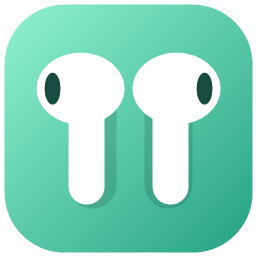
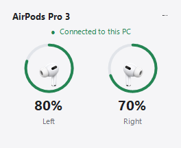
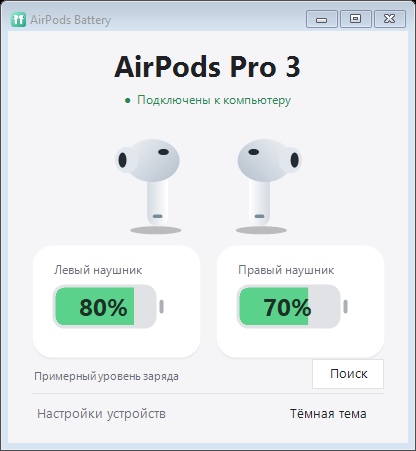

<p align="center"></p>

<h1 align="center">AirPods Battery for Windows</h1>

<p align="center"><strong>English</strong> · <a href="README.ru.md">Русский</a></p>

<p align="center">
  <a href="https://github.com/elnurm/airpods-battery-windows/actions/workflows/build.yml"></a>
  <a href="https://github.com/elnurm/airpods-battery-windows/releases"></a>
  <a href="https://github.com/elnurm/airpods-battery-windows/releases"></a>
  <a href="CONTRIBUTING.md"></a>
  <a href="LICENSE"></a>
</p>

<p align="center"><strong>See your AirPods battery level on Windows 11, right from the system tray.</strong><br>A small, free, open-source desktop app showing left and right earbud percentages, charging state, and disconnect notifications.</p>

<p align="center">Built for everyday listening on a Windows PC.<br><strong>Tested with AirPods Pro 3; other recognized AirPods earbuds are enabled experimentally.</strong><br>Community compatibility reports are welcome.</p>

<p align="center">
  <a href="https://github.com/elnurm/airpods-battery-windows/releases"></a><br>
  Choose AirPodsBatteryDesktop-win-Setup.exe under Assets on the release page.
</p>

<table align="center">
  <tr><th>English</th><th>Русский</th></tr>
  <tr>
    <td></td>
    <td></td>
  </tr>
</table>

*Illustrative app renders with identical synthetic readings, not a claim of precise battery measurement.*

## Features

- Separate left and right earbud battery estimates and charging indicators.
- Compact battery-ring widget with model-specific AirPods illustrations, light/dark themes, and a matching tray icon.
- Drag the header to position the widget; resize from its lower-right edge. Optional always-on-top mode is in the menu.
- Single instance per Windows user session: launching the app again shows the existing window instead of adding another tray icon.
- English and Russian interface. Right-click the tray icon → **Language / Язык** → **English** or **Русский** to switch immediately. Your choice is saved; on first launch the app uses Russian for a Russian Windows UI language, otherwise English.
- Clears percentages when the selected Windows Bluetooth device disconnects.
- Requests one notification per disconnect; waits for fresh data after reconnecting.
- Hover or keyboard-focus a battery indicator for its update time. Old readings visibly show Last known.
- Per-user installer, Start menu shortcut, and uninstall support. No account or custom drivers. Battery monitoring works offline; updates use the internet.

## Download and use

Get **AirPodsBatteryDesktop-win-Setup.exe** from [GitHub Releases](https://github.com/elnurm/airpods-battery-windows/releases). Starting with 0.3.0, releases are installer-only. The `.nupkg` and JSON files are used by the updater; you do not need to open them.

1. Exit any old copy through its tray menu, run the setup program, and open **AirPods Battery for Windows** from the Start menu.
2. Pair and connect your AirPods using Windows Bluetooth settings.
3. The app automatically selects a uniquely connected device named AirPods. For renamed devices or multiple connected pairs, choose your headphones under **Device settings → Windows Bluetooth device**.
4. Battery discovery runs automatically in the background. Keep your AirPods near the PC; opening the case can help discovery.
5. Open **⋯ → Hide widget** to keep it in the tray. Double-click the tray icon to reopen it; choose **Exit** in the menu to quit.

Use **⋯ → Dark mode / Light mode** to switch appearance. Your choice is saved for the next launch. Device settings, rescan, updates, and language are also available in this menu. Battery rings animate when readings change; charging pulses and hover motion respect the Windows animation preference.

Exit any previous copy before opening a new version. The release is unsigned; code signing is not included in this early community release.

**Moving from a portable ZIP:** versions up to 0.2.5 only detect releases containing a ZIP. They cannot notify you about this installer-only migration. Download and run the installer manually once, then stop using the old extracted executable. Your language preference remains in `%LOCALAPPDATA%\AirPodsBattery`; the installed app lives separately under `%LOCALAPPDATA%\AirPodsBatteryDesktop`. Uninstall through Windows Settings → Apps.

**In-app updates:** click an update notification or choose **Check for updates** in the tray menu. Confirm the download, then choose whether to restart and install. Cancelling a download leaves the current app running. Declining restart keeps the downloaded package; check for updates again when ready. Updates are not automatically applied on startup.

## Compatibility

| Model | Status |
| --- | --- |
| AirPods Pro 3 | Battery reception tested on one Windows 11 PC |
| AirPods 1, 2, 3 | Experimental; hardware reports needed |
| AirPods 4 / AirPods 4 with ANC | Experimental; hardware reports needed |
| AirPods Pro / AirPods Pro 2 / Pro 2 USB-C | Experimental; hardware reports needed |
| AirPods Max, Beats, other headphones | Not supported by this version |

Requires **Windows 11 x64**, .NET Framework 4.8 or later, and a Bluetooth adapter/driver that supports BLE scanning. Windows 10, ARM64, and other operating systems have not been validated. Model recognition does not guarantee that every firmware or adapter combination works.

Using an experimental model? [Report whether it works](https://github.com/elnurm/airpods-battery-windows/issues/new?template=compatibility.yml). Include the model, firmware if known, Windows version, and whether each earbud and disconnect notification worked.

## What to expect

**Battery precision:** this app reads the unencrypted Bluetooth Low Energy proximity broadcast. Values are approximate **10% steps**, identified as approximate in the footer (and with `~` in the tray). It does not extract encryption keys or provide exact 1% readings. Case battery is intentionally omitted.

**Connection vs. proximity:** a nearby AirPods broadcast does not mean the headphones are connected to Windows. The app separately checks the selected paired Windows device's connection state. A disconnect clears the stored percentages and bars; broadcasts received while disconnected cannot restore them. Windows may delay reporting the change, and Do Not Disturb or notification preferences may suppress the popup.

**Automatic discovery:** AirPods rotate their BLE address. The app looks for a single fresh battery signal compatible with the selected Windows device name, observes it for five seconds, and remembers its model for the session. It recovers automatically when an address expires. If multiple matching signals are nearby, it clears the automatic selection and waits instead of asking you to choose a broadcast. Changing the Windows device resets the remembered model. BLE signals cannot be authenticated as belonging to the Windows device; even a sole matching signal can belong to another pair.


**Old readings:** while Windows still reports a connection, a missing signal means missing battery data, not a disconnect. Readings older than 60 seconds are muted and labeled Last known. Reading details remain available to screen readers. After two minutes without a supported battery signal, the entry expires and the display clears while automatic discovery continues.

## Troubleshooting

| Symptom | Try this |
| --- | --- |
| No paired device listed | Pair in Windows first, then click Rescan. |
| Disconnected even with earbuds nearby | Connect the selected device to this PC; proximity is not a connection. |
| No battery broadcasts | Open the case near the PC, check Bluetooth, and click Rescan. |
| Updates stop | Check the reading age, keep your AirPods near the PC, and allow automatic discovery to find their new signal. |
| No popup | Check Windows notification preferences; the disconnected state still appears in the app. |
| Experimental model does not work | Submit a compatibility report; avoid posting serial numbers or Bluetooth addresses. |

## Build from source

On a Windows 11 x64 machine, open PowerShell in the repository root:

```powershell
./scripts/build.ps1
./scripts/test.ps1 -IncludeUi
./scripts/package.ps1
```

The build uses the Windows .NET Framework compiler and system WinRT metadata. The first build downloads pinned, checksum-verified Velopack and Newtonsoft.Json dependencies. Packaging also downloads a private .NET runtime and Velopack CLI into `build/dependencies`; no machine-wide SDK install is needed. The executable is written to `build/AirPods.exe`; packaging produces the installer, full update package, feed metadata and `SHA256SUMS.txt` under `dist/v<version>/`. Close a running build before rebuilding it. See [release publishing](docs/UPDATES.md).

GitHub Actions is configured to build, run decoder/connection tests, and produce downloadable build artifacts. It does not publish releases automatically. Hardware Bluetooth tests require a real PC and AirPods; hosted CI cannot establish device compatibility.

## Privacy

The installed app checks this project's public GitHub Releases API at startup and once every 24 hours while running, including preview releases with a Windows update feed. **Check for updates** also checks manually. A notification opens the in-app update flow. Downloading and restarting require your confirmation. Automatic notifications appear once per new version. Windows notification settings may suppress them; **GitHub releases** opens the manual installer download page.

Update checks and downloads contact GitHub over HTTPS. GitHub receives your IP address and request metadata, but no Bluetooth addresses, device names or battery data. No authentication token is used. The last notified version is saved in `%LOCALAPPDATA%\AirPodsBattery\notified-version.txt` to avoid repeating notifications after restarting. Offline or failed automatic checks stay quiet and retry at the next daily check. Velopack verifies package checksums before installation. Trust is based on HTTPS and control of this GitHub repository; packages do not yet have independent publisher signatures or Authenticode signing.

Bluetooth advertisements are read locally. Battery values and device selections are held in memory. The optional `--diagnose` mode writes packet counts and errors beside the executable and does not check for updates; it does not intentionally log raw packets or addresses. Error details may contain local paths, so review logs before sharing them.

Your chosen interface language is stored in `%LOCALAPPDATA%\AirPodsBattery\language.txt`. Device names and model names remain unchanged when switching languages.

## Contributing and license

More interface languages are planned. Translation suggestions and contributions are welcome; English and Russian are the currently supported languages.

See [CONTRIBUTING.md](CONTRIBUTING.md) for bug reports, compatibility feedback, and development notes. The project is released under the [MIT license](LICENSE). Protocol references and trademark information are in [NOTICE.md](NOTICE.md).
