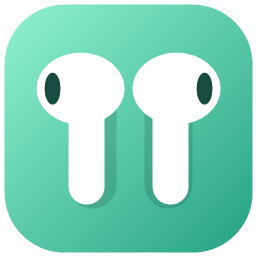
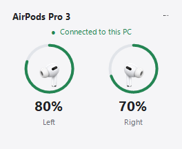
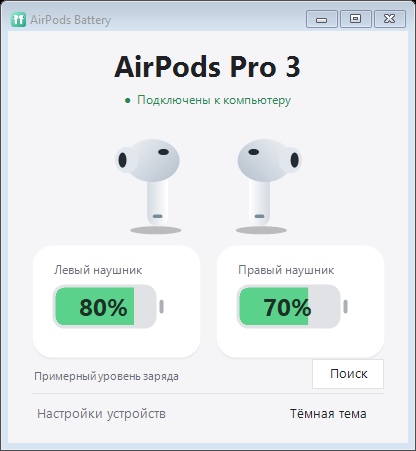

<h1 align="center">AirPods Battery for Windows</h1>

<a href="README.md">English</a> · <strong>Русский</strong>

  
  
  
  
  

Бесплатный виджет заряда AirPods для Windows 11 с открытым исходным кодом. Заряд левого и правого наушника, индикаторы зарядки и уведомления об отключении.

   
  Скачайте <strong>AirPodsBatteryDesktop-win-Setup.exe</strong> из раздела Assets на странице выпуска.

<table align="center">
  <tr><th>English</th><th>Русский</th></tr>
  <tr>
    <td></td>
    <td></td>
  </tr>
</table>

*На снимках показаны демонстрационные значения.*

## Возможности

- Компактный перетаскиваемый виджет с кольцами заряда и иллюстрациями разных моделей AirPods.
- Светлая/тёмная тема, режим «Поверх всех окон» и значок в системном трее.
- Автоматический поиск данных о заряде и уведомления об отключении.
- Английский и русский интерфейс, обновления внутри приложения.

## Как пользоваться

1. Установите приложение и подключите AirPods в настройках Bluetooth Windows.
2. Откройте приложение. Поиск заряда выполняется автоматически; открытие футляра рядом с ПК может помочь.
3. В меню **⋯** доступны настройки, язык, тема, обновления и **Скрыть виджет**. Двойной щелчок по значку в трее снова откроет окно; **Выход** завершит приложение.

Если наушники переименованы или подключено несколько пар, выберите свои в **⋯ → Настройки устройств**.

## Совместимость

**Проверено с AirPods Pro 3.** AirPods 1–4, AirPods Pro и Pro 2 поддерживаются экспериментально. AirPods Max и Beats не поддерживаются.

Нужны **Windows 11 x64**, .NET Framework 4.8+ и Bluetooth с поддержкой сканирования BLE. Установщик пока без цифровой подписи.

- Заряд приблизительный, с шагом **10%**; заряд футляра не отображается.
- Устаревшие значения помечаются как **Последние данные** и очищаются через две минуты без сигнала.
- Несколько пар одной модели поблизости могут мешать автоматическому определению.

Данные о заряде остаются на вашем ПК. Проверка и загрузка обновлений используют GitHub.

[Подробности и решение проблем](docs/DETAILS.ru.md) · [Обновления и переход с ZIP](docs/UPDATES.md) (EN) · [История изменений](docs/CHANGELOG.md) (EN)

## Обратная связь и разработка

[Сообщите о совместимости](https://github.com/elnurm/airpods-battery-windows/issues/new?template=compatibility.yml) или [создайте issue](https://github.com/elnurm/airpods-battery-windows/issues). Помощь с разработкой и переводами приветствуется.

[Сборка из исходников](docs/DETAILS.ru.md#сборка-из-исходников) · [Участие в разработке](CONTRIBUTING.md) (EN) · [Лицензия MIT](LICENSE) · [Благодарности](NOTICE.md) (EN)
