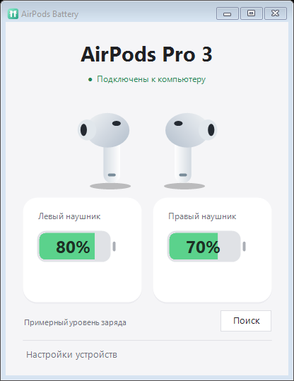

<p align="center"></p>

<h1 align="center">AirPods Battery for Windows</h1>

<p align="center"><a href="README.md">English</a> · <strong>Русский</strong></p>

<p align="center">
  <a href="https://github.com/elnurm/airpods-battery-windows/actions/workflows/build.yml"></a>
  <a href="https://github.com/elnurm/airpods-battery-windows/releases"></a>
  <a href="https://github.com/elnurm/airpods-battery-windows/releases"></a>
  <a href="CONTRIBUTING.md"></a>
  <a href="LICENSE"></a>
</p>

<p align="center"><strong>Узнайте заряд AirPods в Windows 11 прямо из системного трея.</strong><br>Бесплатное приложение с открытым исходным кодом: заряд левого и правого наушника, состояние зарядки и уведомления об отключении.</p>

<p align="center"><strong>Проверено с AirPods Pro 3. Поддержка остальных распознаваемых моделей — экспериментальная.</strong><br>Будем рады отзывам о совместимости.</p>

<p align="center">
  <a href="https://github.com/elnurm/airpods-battery-windows/releases"></a><br>
  На странице выпуска выберите ZIP для Windows x64 в разделе Assets.
</p>

<table align="center">
  <tr><th>English</th><th>Русский</th></tr>
  <tr>
    <td></td>
    <td></td>
  </tr>
</table>

*На снимках показаны одинаковые демонстрационные значения. Они не означают, что приложение измеряет заряд с точностью до 1%.*

## Возможности

- Раздельные приблизительные значения заряда левого и правого наушника и индикаторы зарядки.
- Светлый интерфейс, индикаторы батареи в стиле iPhone и значок в системном трее.
- Изменяемый размер окна, разворачивание и центрирование содержимого. Минимальный размер не позволяет обрезать элементы управления.
- Один экземпляр приложения на сеанс пользователя Windows: повторный запуск открывает существующее окно.
- Английский и русский интерфейс. Нажмите правой кнопкой на значок в трее → **Language / Язык → Русский**. Язык меняется сразу и сохраняется. При первом запуске используется русский язык, если язык интерфейса Windows — русский; иначе английский.
- При отключении выбранного устройства данные о заряде очищаются. После подключения приложение ждёт свежих данных.
- Уведомление об отключении и время последнего обновления при наведении на индикатор батареи или переходе к нему клавишей Tab.
- Портативное приложение: без учётной записи, установщика и дополнительных драйверов. Проверка заряда работает без интернета; интернет нужен для проверки обновлений.

## Скачать и запустить

Скачайте ZIP из [GitHub Releases](https://github.com/elnurm/airpods-battery-windows/releases).

1. Распакуйте архив и запустите **AirPods.exe**. Файл **AirPods.ico** должен оставаться рядом.
2. Выполните сопряжение AirPods и подключите их в настройках Bluetooth Windows.
3. Откройте **Настройки устройств**. В списке **Устройство Bluetooth в Windows** выберите свои наушники. Если найдено только одно сопряжённое устройство с AirPods в имени, оно выбирается автоматически; переименованное устройство можно выбрать вручную.
4. В списке **Сигналы AirPods поблизости** выберите сигнал своих наушников. Для обнаружения можно открыть футляр рядом с компьютером.
5. Закройте окно — приложение останется в трее. Двойной щелчок по значку снова откроет окно; **Выход** в меню значка завершит приложение.

Перед установкой новой версии завершите предыдущую через меню трея. Это предварительная версия без цифровой подписи.

## Совместимость

| Модель | Статус |
| --- | --- |
| AirPods Pro 3 | Получение данных проверено на одном ПК с Windows 11 |
| AirPods 1, 2, 3 | Экспериментально; нужны отзывы владельцев |
| AirPods 4 / AirPods 4 с ANC | Экспериментально; нужны отзывы владельцев |
| AirPods Pro / AirPods Pro 2 / Pro 2 USB-C | Экспериментально; нужны отзывы владельцев |
| AirPods Max, Beats и другие наушники | Не поддерживаются |

Нужны **Windows 11 x64**, .NET Framework 4.8 или новее и Bluetooth-адаптер с драйвером, поддерживающим сканирование BLE. Windows 10, ARM64 и другие ОС не проверялись. Распознавание модели не гарантирует работу с любой прошивкой и адаптером.

[Расскажите о совместимости](https://github.com/elnurm/airpods-battery-windows/issues/new?template=compatibility.yml): укажите модель, прошивку (если известна), версию Windows, работу каждого наушника и уведомления об отключении.

## Особенности работы

**Точность заряда.** Приложение читает незашифрованные сигналы Bluetooth Low Energy. Данные поступают с шагом **10%** и отображаются как приблизительные (в трее — со знаком `~`). Приложение не извлекает ключи шифрования и не предоставляет точность до 1%. Заряд футляра не отображается.

**Сигнал рядом — не подключение.** Приложение отдельно проверяет подключение выбранного устройства к Windows. При отключении заряд очищается; сигналы поблизости не восстанавливают эти значения. Windows может сообщать об отключении с задержкой, а настройки уведомлений или режим «Не беспокоить» могут скрывать всплывающее сообщение.

**Почему два списка?** AirPods меняют адрес BLE. Приложение не может достоверно связать сигнал с выбранным устройством Windows. Лучше выбирать свои наушники вдали от других AirPods. После выбора модель запоминается на текущий сеанс. Когда старый адрес исчезает, приложение автоматически выбирает единственный свежий сигнал той же модели после пяти секунд наблюдения. Если совпадений несколько, нужен ручной выбор. Появление второго совпадения также отменяет автоматический выбор. Смена устройства Windows сбрасывает запомненную модель. Даже единственный подходящий сигнал может принадлежать чужим наушникам.

**Фильтр моделей.** После выбора сигнала другие модели скрываются. Чтобы сменить модель, включите **Показать все модели AirPods**. После выбора фильтр применяется снова. Другие пары той же модели остаются видимыми; фильтр не подтверждает принадлежность наушников.

**Устаревшие данные.** Если Windows по-прежнему сообщает о подключении, отсутствие сигнала означает отсутствие новых данных о заряде, а не отключение. Через 60 секунд значения становятся приглушёнными и помечаются как **Последние данные**. Время обновления видно при наведении или фокусе с клавиатуры. В списке отображаются время последнего сигнала и его уровень в dBm; через две минуты без обновлений запись удаляется. Если выбранная запись исчезла, заряд очищается и открываются настройки. Сила сигнала не определяет, кому принадлежат наушники.

## Решение проблем

| Проблема | Что попробовать |
| --- | --- |
| Нет устройства в верхнем списке | Сначала выполните сопряжение в Windows, затем нажмите «Поиск». |
| Наушники рядом, но показано отключение | Подключите выбранное устройство к этому ПК. Близость не означает подключение. |
| Нет сигналов с данными о заряде | Откройте футляр рядом с ПК, проверьте Bluetooth и нажмите «Поиск». |
| Заряд перестал обновляться | Проверьте время последнего сигнала и выберите новую запись, если адрес изменился. |
| Нет уведомления | Проверьте настройки уведомлений Windows. Состояние отключения всё равно отображается в приложении. |
| Не работает экспериментальная модель | Отправьте отчёт о совместимости без серийных номеров и Bluetooth-адресов. |

## Сборка из исходников

На ПК с Windows 11 x64 откройте PowerShell в корне репозитория:

```powershell
./scripts/build.ps1
./scripts/test.ps1 -IncludeUi
./scripts/package.ps1
```

Используются компилятор .NET Framework и системные метаданные WinRT; загрузка пакетов не требуется. Приложение создаётся в `build/AirPods.exe`, ZIP и контрольная сумма SHA-256 — в `dist/`. Перед пересборкой завершите запущенное приложение.

GitHub Actions собирает приложение, запускает автоматические тесты и сохраняет артефакты сборки. Выпуски автоматически не публикуются. Для проверки Bluetooth нужны настоящий ПК и AirPods; CI не подтверждает совместимость оборудования.

## Конфиденциальность и обновления

Приложение обращается к публичному API GitHub Releases при запуске и раз в 24 часа во время работы. Ручная проверка доступна в меню трея: **Проверить обновления**. Учитываются предварительные выпуски с ZIP для Windows. Уведомление открывает страницу выпуска; загрузка и установка выполняются вручную. Автоматическое уведомление появляется один раз для каждой новой версии. Если Windows скрывает уведомления, используйте пункт **Версии на GitHub**.

GitHub получает ваш IP-адрес и версию приложения в заголовке User-Agent, но не Bluetooth-адреса, названия устройств или данные о заряде. Токен авторизации не используется, телеметрия не отправляется. Последняя версия, о которой было уведомление, сохраняется в `%LOCALAPPDATA%\AirPodsBattery\notified-version.txt`. При ошибке сети автоматическая проверка проходит без уведомления об ошибке и повторяется при следующей ежедневной проверке.

Сигналы Bluetooth обрабатываются локально. Данные о заряде и выбранные устройства хранятся в памяти. Режим `--diagnose` записывает счётчики пакетов и ошибки рядом с приложением, не проверяет обновления и не предназначен для записи необработанных пакетов или адресов. Сообщения об ошибках могут содержать локальные пути; проверьте журнал перед публикацией.

Выбранный язык сохраняется в `%LOCALAPPDATA%\AirPodsBattery\language.txt`. Названия моделей и устройств при смене языка не изменяются.

## Участие в разработке и лицензия

О сообщениях об ошибках, совместимости и разработке читайте в [CONTRIBUTING.md](CONTRIBUTING.md) (на английском). Проект распространяется по [лицензии MIT](LICENSE). Ссылки на описание протокола и информация о товарных знаках — в [NOTICE.md](NOTICE.md).
